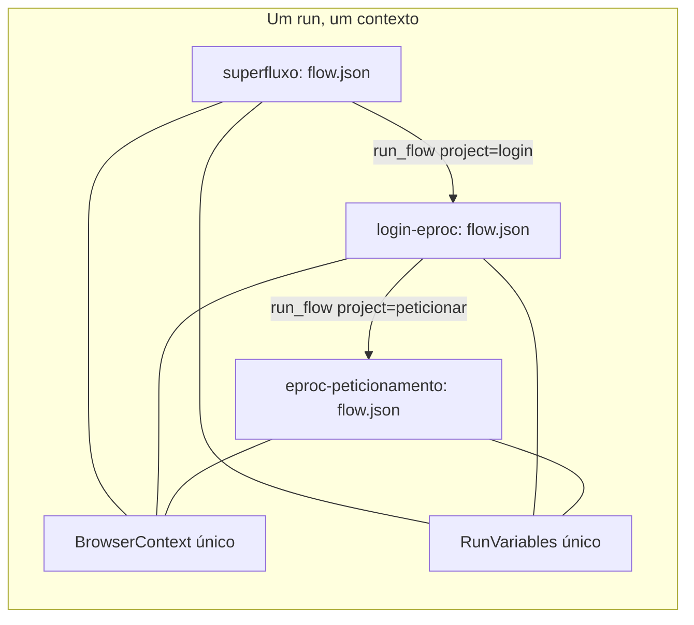

# Composição de fluxos: do subfluxo ao superfluxo

## Objetivo

Permitir **encadear fluxos principais** — não só subfluxos — de modo que o fluxo seguinte **assuma o contexto deixado pelo anterior**: a mesma sessão de navegador (portanto a mesma tela), o mesmo Excel/Word abertos e a mesma tabela de variáveis. Caso motivador: `examples/login-eproc` termina no painel do advogado já logado; um segundo fluxo deve continuar dali para peticionar, sem relogar e sem refazer a navegação.

A pergunta de projeto era: **qual é a menor extensão do modelo atual que entrega isso sem criar um segundo motor de execução?**

Resposta implementada: o nó **`run_flow`** ganhou o campo **`project`**, que resolve o fluxo chamado em **outro projeto** declarado em **`manifest.linked_projects`**. Um **superfluxo** não é um formato novo: é um projeto comum cujo fluxo principal encadeia chamadas a outros projetos. Tudo o que já existe (validação, telemetria, CLI, Studio, `inherit`/`isolated`) continua valendo.

---

## 1. O que já existia

| Peça | Onde | Situação antes |
|------|------|----------------|
| Nó `run_flow` | [`ActionKind.cs`](../../src/Hoblio.Model/ActionKind.cs) | 3 alvos: subfluxo embutido (`subflows`), id em `manifest.flows`, caminho relativo |
| Resolução do filho | [`ChildFlowResolver.cs`](../../src/Hoblio.Serde/ChildFlowResolver.cs) | Tudo resolvido **dentro da raiz do projeto**; `ResolveProjectFlowPath` rejeita caminhos para fora |
| Serviços por run | [`FlowExecutor.RunProject`](../../src/Hoblio.Runtime/FlowExecutor.cs) | `BrowserContext`, `ExcelContext`, `WordContext` e `RunVariables` criados **uma vez** e passados a `ExecuteGraph` |
| Escopo de variáveis | [`RunFlowSupport.cs`](../../src/Hoblio.Runtime/RunFlowSupport.cs) | `variable_scope: inherit` (mesma tabela) ou `isolated` (snapshot + merge de `outputs`) |
| Contrato | nó `run_flow` | `inputs` (mapa variável → template) e `outputs` (nomes) |
| Demo de orquestração | `examples/flow-compose-demo` | Orquestrador chamando `flows/*.json` **do mesmo projeto** |

Consequências diretas:

1. **A sessão do navegador já era herdada.** Como `browser` é único por run, qualquer `run_flow` — inclusive um arquivo filho — executa no mesmo Chrome já aberto. O `share_browser` do painel de propriedades **não é lido pelo runtime** (só existe no modelo e no Studio); hoje ele é metadado inerte.
2. **Compor fluxos principais era impossível** por um motivo pequeno e específico: a resolução do filho era confinada à raiz do projeto. Não havia como dizer "chame o fluxo principal do projeto `../login-eproc`".
3. **Cada chamada reentregava o manifest e a raiz do pai** ao filho (`ExecuteGraph(..., manifest, projectRoot, ...)`), o que impediria um projeto vinculado de resolver seus próprios `manifest.flows` e seus próprios caminhos de arquivo.
4. **Nada declarava o contrato entre fluxos principais**: `outputs` era só rótulo de log; a validação de `{variáveis}` conhecia apenas produtores do próprio grafo.

---

## 2. O que o Power Automate Desktop faz (e o que não copiar)

No produto (comportamento observável na UI; o pacote em `dotnet\` confirma a separação em `Robin.Engine` de ações × instância de robô), a composição existe em **dois níveis**:

| Nível PAD | Unidade de execução | Contrato |
|-----------|---------------------|----------|
| **Subflow** ("Executar subfluxo") | mesma execução | variáveis de entrada/saída do subfluxo |
| **Desktop flow** ("Executar fluxo de desktop") | execução **separada** (outro processo/sessão) | variáveis consumidas/produzidas; sessão do navegador só é reaproveitada anexando à instância existente |

O PAD paga por um preço que aqui não se quer pagar: para o caso "leve o navegador até a tela X e continue", chamar outro desktop flow significa **outra execução** — com novo escopo de variáveis, nova sessão (ou attach explícito por CDP) e log desconexo. A herança de tela só existe se o autor lembrar de anexar à instância.

O Elfio já tem a peça que o PAD não tem de graça: **um único run com serviços compartilhados**. Então a decisão foi não copiar o modelo de "nova execução", e sim estender o `run_flow` para atravessar a fronteira do projeto **dentro do mesmo run**.

| Alternativa | Isolamento | Herda a tela | Custo |
|-------------|-----------|--------------|-------|
| Novo run por projeto (modelo PAD) | alto | só via `browser_attach`/CDP | médio, mas quebra o log e o estado |
| Mesmo run, projeto vinculado (**escolhido**) | baixo (por desenho) | sim, de graça | baixo |

---

## 3. Alternativas avaliadas

| # | Desenho | Prós | Contras | Veredito |
|---|---------|------|---------|----------|
| **A** | Liberar `path` para fora da raiz, sem declarar nada | 3 linhas de código | Referência invisível, não validável, dependência escondida no grafo, caminho relativo ambíguo (`../` a partir de onde?), sem contrato | rejeitada |
| **B** | `run_flow.project` + `manifest.linked_projects` (**implementada**) | Reusa 100% do motor, validação, telemetria, CLI e Studio; dependências explícitas e auditáveis; contrato declarado; recursivo | Exige um campo novo em 6 pontos da UI; herança é implícita no espaço de variáveis | **escolhida** |
| **C** | Documento novo `suite.json` + `SuiteExecutor` | "Superfluxo" como artefato de primeira classe | Duplica executor, validador, log e CLI; dois modelos mentais; `if`/`loop` entre etapas teria de ser reinventado | rejeitada |
| **D** | Herança declarativa no grafo (`"inherits": "login-eproc"`) | Sintaxe curta | Ordem implícita, difícil compor 3+, "rodar só este fluxo" passa a rodar a linhagem inteira; depuração confusa | rejeitada (açúcar sobre B, se necessário) |
| **E** | Handoff entre runs distintos (`browser_attach` por CDP) | Processos isolados, retomada manual | Não é composição: é reencontro por porta de debug; log partido | ortogonal, mantida para replay/inspeção |

**Decisão:** B. O superfluxo é uma *convenção de uso* do que já existe — um projeto cujo `flow.json` encadeia `run_flow` com `project` — e não um novo tipo de arquivo. Isso mantém a propriedade mais valiosa do sistema: **um único interpretador**.

---

## 4. Dois níveis de composição

| | Subfluxo (existente) | Fluxo principal vinculado (novo) |
|---|---|---|
| Onde vive | `flow.json` → `subflows` (no mesmo arquivo) | outro **projeto** (pasta com `manifest.json` + `flow.json`) |
| Visibilidade | caixa branca: editável na mesma aba do Studio | caixa preta: contrato declarado |
| Variáveis | mesma tabela (`inherit`) | mesma tabela (`inherit`) ou `isolated` |
| Contrato | nenhum (acesso direto) | `requires` / `exports` no vínculo + `inputs`/`outputs` na chamada |
| Versionável sozinho | não | sim (projeto/repositório próprio) |
| Reuso entre fluxos | dentro do arquivo | em qualquer superfluxo |
| Resolução | `flow_id` / `path` | `project` (+ `flow_id` opcional) |

Regra prática: **subfluxo** é "função interna"; **fluxo vinculado** é "serviço com contrato". O mesmo fluxo principal pode ser subfluxo embutido de um projeto e projeto vinculado de outro.

---

## 5. Modelo de dados

### 5.1 Chamada (`flow.json`)

```json
{
  "id": "rf_peticao",
  "kind": "action",
  "label": "2. Peticionamento",
  "action": {
    "type": "run_flow",
    "project": "peticionar",
    "inputs": { "ScreenText": "{ScreenText}", "SessionUser": "{SessionUser}" },
    "outputs": ["PetitionNumber"],
    "variable_scope": "inherit"
  }
}
```

| Campo | Semântica |
|-------|-----------|
| `project` | id em `manifest.linked_projects`. Ausente → resolução local (comportamento antigo) |
| `flow_id` | id em `manifest.flows` **do projeto vinculado**; ausente → fluxo de entrada do projeto |
| `path` | alternativa a `flow_id`, relativa à raiz **do projeto vinculado** |
| `inputs` | valores aplicados antes da execução (`inherit`: sobrepõe; `isolated`: semente do filho) |
| `outputs` | nomes devolvidos ao pai em `isolated`; em `inherit` é contrato/telemetria |
| `variable_scope` | `inherit` (padrão) compartilha a tabela — é o que permite a herança da tela |

### 5.2 Vínculo (`manifest.json`)

```json
{
  "name": "eproc-superflow",
  "version": "0.1.0",
  "entry_flow": "flow.json",
  "linked_projects": {
    "login": {
      "path": "../login-eproc",
      "description": "Login + seleção de perfil; termina no painel do advogado",
      "exports": ["ScreenText", "EprocUrl", "EprocUser"]
    },
    "peticionar": {
      "path": "../eproc-peticionamento",
      "requires": ["ScreenText", "SessionUser"],
      "exports": ["PetitionNumber"]
    }
  }
}
```

| Campo | Função |
|-------|--------|
| `path` | pasta do projeto vinculado, **relativa** à pasta do `manifest.json` chamador (nunca absoluta) |
| `description` | documentação do vínculo (aparece no Studio) |
| `flow` | id do fluxo de entrada nesse projeto, quando não é o `entry_flow` |
| `requires` | variáveis que o projeto espera receber (contrato documental + picker do Studio) |
| `exports` | variáveis que o projeto entrega — **entram como variáveis conhecidas do chamador** |
| `linked_projects` | allow-list explícita: nada fora daqui pode ser chamado |

Duas semânticas de "fluxo de entrada" que convém não confundir:

- **projeto chamador**: a raiz do run é sempre `flow.json` (`ProjectLoader.LoadProject` ignora `entry_flow` para carregar o grafo principal);
- **projeto vinculado**: sem `flow_id`/`path`, o fluxo de entrada é o `entry_flow` do manifest dele (id em `manifest.flows` ou caminho relativo); se `entry_flow` for `flow.json` ou estiver ausente, é o próprio `flow.json`. Ver `ResolveEntryFlow` em [`ChildFlowResolver`](../../src/Hoblio.Serde/ChildFlowResolver.cs).

O manifest é a **fronteira de confiança**: um fluxo não consegue alcançar um projeto arbitrário do disco sem que esse projeto esteja declarado e validado. `exports` é o que torna a herança **verificável em tempo de projeto**: `{ScreenText}` num nó do superfluxo passa pelo [`TemplateReferenceValidator`](../../src/Hoblio.Model/TemplateReferenceValidator.cs) mesmo sem produtor local.

---

## 6. Semântica de herança

O que o fluxo filho recebe, na prática:

| Recurso | Herdado? | Observação |
|---------|----------|------------|
| Sessão do navegador (aba, tela, cookies, perfil) | **sim** | um `BrowserContext` por run |
| Excel / Word abertos (`ExcelContext`, `WordContext`) | **sim** | idem |
| Variáveis (`ScreenText`, `EprocUrl`, …) | **sim** com `inherit`; só `outputs` com `isolated` | tabela única em `RunVariables` |
| Raiz de caminhos de arquivo | **a raiz do projeto chamado** | `projectRoot` passado para `ActionExecutor` é o do filho — cada projeto é dono dos seus arquivos |
| `manifest` para resolver `run_flow`/`manifest.flows` | **o do projeto chamado** | correção necessária para aninhar vínculos |
| Controle de fluxo (loops, frames de switch) | **não** | cada grafo abre seu próprio `loopFrames`; o filho começa no seu `start` e termina no seu `end` |
| Sessão de usuário/janela do SO | sim (mesmo processo) | não há troca de contexto Windows |

O que **não** existe: serialização/retomada de estado. "Herdar a tela" significa que o navegador é o mesmo objeto vivo; não há snapshot para replay. Depois que o `BrowserContext` fecha, o estado acabou.



---

## 7. Validação implementada

| Verificação | Onde | Erro |
|-------------|------|------|
| `run_flow` precisa de `flow_id`, `path` ou `project` | `GraphValidator` | `ActionNodeMissingAction` |
| `project` precisa existir em `linked_projects` | `GraphValidator` | `UnknownLinkedProject` |
| `requires`/`exports` com nomes de variável válidos | `GraphValidator` | `InvalidLinkedProject` |
| `path` do vínculo é relativo e existe (`manifest.json` + `flow.json`) | `LinkedProjectValidator` | `InvalidLinkedProject` |
| `flow`/`flow_id` referenciado existe no projeto vinculado | `LinkedProjectValidator` | `InvalidLinkedProject` |
| Ciclo entre projetos (A → B → A) | `LinkedProjectValidator` | `InvalidLinkedProject` (`linked project cycle detected: a -> b -> a`) |
| Profundidade da cadeia ≤ 16 | `LinkedProjectValidator` + runtime | idem / `run_flow exceeds maximum depth` |
| `{vars}` do chamador satisfeitas por `exports` | `TemplateReferenceValidator` | `UnknownTemplateReference` |

`LinkedProjectValidator` roda em `hoblio validate`, no Studio (Validar/Executar) e no início de `FlowExecutor.RunProject`. A validação é **eager**: falha antes do primeiro nó, com mensagem apontando o vínculo e o nó.

---

## 8. Implementação (o que mudou)

| Camada | Arquivo | Mudança |
|--------|---------|---------|
| Modelo | [`Project.cs`](../../src/Hoblio.Model/Project.cs) | `FlowManifest.LinkedProjects` + `LinkedProject { Path, Description?, Flow?, Requires?, Exports? }` |
| Modelo | [`ActionKind.cs`](../../src/Hoblio.Model/ActionKind.cs) | `RunFlowAction.Project` |
| Modelo | [`ActionKindJsonConverter.cs`](../../src/Hoblio.Model/Json/ActionKindJsonConverter.cs) | leitura/gravação de `project` |
| Modelo | [`GraphValidator.cs`](../../src/Hoblio.Model/GraphValidator.cs) | `ValidateLinkedProjects` (id declarado, nomes do contrato) |
| Modelo | [`TemplateReferenceValidator.cs`](../../src/Hoblio.Model/TemplateReferenceValidator.cs) | `exports` como variáveis conhecidas; varredura de subfluxos embutidos |
| Serde | [`ChildFlowResolver.cs`](../../src/Hoblio.Serde/ChildFlowResolver.cs) | resolução cross-project, escolha do fluxo de entrada, cache por run (`ChildFlowCache`) |
| Serde | [`LinkedProjectValidator.cs`](../../src/Hoblio.Serde/LinkedProjectValidator.cs) | novas validações (disco, ciclo, profundidade) |
| Serde | [`ProjectLoader.cs`](../../src/Hoblio.Serde/ProjectLoader.cs) | `ValidateProjectDir` inclui vínculos |
| Runtime | [`FlowExecutor.cs`](../../src/Hoblio.Runtime/FlowExecutor.cs) | filho executa com **seu** manifest e **sua** raiz; rótulo `projeto:fluxo` |
| Studio | [`LinkedProjectOps.cs`](../../src/Hoblio.Studio/LinkedProjectOps.cs) | operações puras do vínculo: caminho relativo, id único, validação da pasta, `Plan`/`Apply` |
| Studio | `PropertiesPanel.xaml`, `FlowEditorViewModel.RunFlow.cs` | campo **Projeto vinculado** + botões **Vincular projeto…** e **Novo vinculado…** + dica do vínculo |
| CLI | (sem mudança) | `validate`/`run` já cobrem o superfluxo |
| Exemplos | `examples/superflow-*` | superfluxo executável + dois fluxos principais |
| Testes | `SuperflowTests`, `LinkedProjectManifestTests`, `LinkedProjectOpsTests` | herança, `isolated`, vínculo ausente, caminho inválido, ciclo, `exports`, JSON, caminho relativo/id |

Detalhe de correção importante: antes, `ExecuteGraph` repassava `manifest` e `projectRoot` do **pai** ao filho. Com vínculos isso quebraria projetos que têm `flows/` próprios e caminhos de arquivo relativos. Agora `ResolvedChildFlow` carrega `Manifest` e `ProjectRoot` do filho (iguais aos do pai em subfluxo/arquivo local, diferentes em projeto vinculado).

---

## 9. Como usar

### 9.1 No Studio

O Studio é **um projeto por vez**. Compor um superfluxo é: abrir o projeto orquestrador, arrastar um nó `run_flow` e apontá-lo para outro projeto.

1. **Abrir** o projeto que vai orquestrar (ex.: um projeto novo salvo em `examples/eproc-superflow`). Salve-o: o vínculo é gravado no `manifest.json` **desta** pasta.
2. Paleta → **Executar fluxo** (`run_flow`, ícone ⎇) → arraste para o canvas.
3. Selecione o nó. Em **Propriedades → Projeto vinculado**:
   - **Vincular projeto…** → escolhe a pasta de um projeto Elfio já existente (precisa ter `manifest.json` + `flow.json`). O Studio grava `linked_projects.<id>` com caminho relativo (ex.: `../login-eproc`), gera um id único a partir do nome da pasta e **já aponta o nó** para esse id.
   - **Novo vinculado…** → cria um projeto novo (Irmão desta pasta, com `manifest.json` + `flow.json` mínimo) e o vincula na mesma ação. Depois abra-o por **Abrir… → manifest.json** para montar o fluxo.
   - O ComboBox lista os vínculos já declarados; a linha cinza abaixo mostra o caminho e o contrato (`exporta:` / `requer:`).
4. Ajuste **Flow id** quando o projeto vinculado tiver mais de um fluxo em `manifest.flows` (vazio = fluxo de entrada do projeto).
5. Deixe **Variable scope = inherit** para herdar a sessão/tela; use `isolated` quando não quiser contaminação.
6. Em **Inputs**, passe o estado explicitamente (`ScreenText={ScreenText}`) e, em **Outputs**, liste o que o próximo passo pode usar.
7. **Salvar** (grava `linked_projects` + o nó) → **Validar** → **Executar**. O log mostra `run_flow \`login:entry\` finished at \`end\`` e as variáveis herdadas.

Observações de uso:

- O vínculo entra no **undo/redo** e deixa o documento sujo (`*` no título) até salvar.
- Para editar o projeto vinculado é preciso **Abrir…** a pasta dele; o Studio não abre dois projetos ao mesmo tempo.
- Também é possível editar `linked_projects` à mão no `manifest.json` — o Studio apenas reflete o que está lá.

### 9.2 Pela CLI

```powershell
dotnet run --project src/Hoblio.Cli -- validate examples/superflow-demo
dotnet run --project src/Hoblio.Cli -- run examples/superflow-demo --jsonl
```

### 9.3 O caso eproc (já montado em `examples/`)

```
examples/
  login-eproc/                 # chamado: login + seleção de perfil; termina no painel
  eproc-peticionamento/        # chamado: assume o painel e protocola
  eproc-superflow/             # orquestrador: declara os dois vínculos
```

Fluxo: `start → run_flow(login) → switch {ScreenText} → run_flow(peticionar) → log → end`, com ramo `case_default` que aborta quando a tela não é o painel.

`examples/eproc-superflow/manifest.json`:

```json
{
  "name": "eproc-superflow",
  "version": "0.1.0",
  "entry_flow": "flow.json",
  "linked_projects": {
    "login": {
      "path": "../login-eproc",
      "exports": ["ScreenText", "EprocUrl", "EprocUser"]
    },
    "peticionar": {
      "path": "../eproc-peticionamento",
      "requires": ["ScreenText", "EprocUrl", "EprocUser"],
      "exports": ["PetitionNumber"]
    }
  }
}
```

O que foi ajustado para a cadeia funcionar:

| Onde | Ajuste |
|------|--------|
| `login-eproc` | o nó final `action_mvsnv0r6` era `show_message` ("Painel do Advogado") — **modal, bloqueava a cadeia**. Virou `log` com o mesmo texto. É o ponto de handoff. |
| `eproc-peticionamento` | primeira ação é `browser_wait_for "#main-menu > li:nth-child(16) > a"` — assume a tela, **não navega**. Depois executa as etapas 1–10 do peticionamento (menu → localidade/rito/área/classe → "Não se aplica" → próxima → filtro de assunto + Enter → seleciona assunto → Incluir → próxima) e encerra registrando que as fases 3–4 ainda não estão mapeadas. `dropdown_mode: by_index` é **0-based** (`option:nth-child(N)` → `N-1`); a localidade usa `by_value "8"` porque o valor é conhecido. |

Detalhe nó a nó, decisões (Enter via script, seletor do assunto, retentativas) e o que falta: [fluxo-eproc-peticionamento.md](./fluxo-eproc-peticionamento.md).

Rodar de fato exige Chrome + credenciais do eproc: `hoblio run examples/eproc-superflow`. Sem isso, use `validate` (checa vínculos, ciclo, `{refs}`) — que é o que garante que o "linkar" ficou correto.

Os dois nós que fazem o elo (`examples/eproc-superflow/flow.json`):

```json
{ "id": "rf_login", "kind": "action", "label": "1. Login eproc (perfil advogado)",
  "action": { "type": "run_flow", "project": "login",
              "outputs": ["ScreenText", "EprocUrl", "EprocUser"] } }
```

```json
{ "id": "rf_peticao", "kind": "action", "label": "2. Peticionamento (assume a tela)",
  "action": { "type": "run_flow", "project": "peticionar",
              "inputs": { "ScreenText": "{ScreenText}", "EprocUrl": "{EprocUrl}", "EprocUser": "{EprocUser}" },
              "outputs": ["PetitionNumber"] } }
```

E a primeira ação do fluxo chamado (assumir, não navegar):

```json
{ "type": "browser_wait_for", "selector": "#btn-home > i", "timeout_ms": 5000 }
```

Se a tela não for a esperada, o `switch`/`if` do superfluxo decide (abortar, relogar, pedir intervenção) — a decisão fica no orquestrador, não escondida no filho.

---

## 10. Limitações e próximos passos

| Item | Situação | Próximo passo sugerido |
|------|----------|------------------------|
| `share_browser: false` | **inerte**: o runtime sempre compartilha a sessão | honrar criando `BrowserContext` próprio para o filho (isolamento real de tela) |
| `requires` | documental; não é verificado contra o que o pai realmente tem | checagem de cobertura por dominância no grafo (aviso/erro configurável) |
| Isolamento de processo | inexistente: um `crash` do browser derruba o run inteiro | etapa "em processo separado" reaproveitando `browser_attach` (padrão PAD) |
| Retomada após falha | não há: o run é contínuo | persistir `project` + nó corrente para retomar no meio da cadeia |
| Depuração passo a passo | não há (run contínuo) | pausa após `NodeEnter` atravessando projetos |
| Versionamento do vínculo | só `path` | aceitar `version`/`hash` no vínculo e avisar quando o contrato mudar |
| Paralelismo | não há suporte a ramos paralelos | `for_each` sobre projetos (ações já são sequenciais por desenho) |
| UI | vincular/criar projeto no inspector do `run_flow`; sem assistente de "superfluxo completo" | assistente que gera o grafo com N etapas e as abas dos projetos vinculados |

Riscos conhecidos: caminhos relativos são resolvidos por `Path.GetFullPath` (sensível a `..`), comparações de cache usam minúsculas (Windows), e um vínculo apontando para pasta inexistente falha no `validate` — por desenho.

---

## 11. Decisões de projeto (registro)

1. **Uma primitiva, não duas.** Estender `run_flow` em vez de criar nó/artefato novo mantém interpretador, validador, telemetria e CLI únicos.
2. **Superfluxo é projeto.** Ganha pasta, `manifest.json`, versionamento e pode ser vinculado por outro superfluxo — composição recursiva sem código extra.
3. **Manifest como fronteira de confiança.** Nenhum caminho arbitrário: só o que está em `linked_projects`.
4. **Contrato declarado, não inferido.** `exports`/`requires` permitem validar `{vars}` antes de rodar e documentam o handoff.
5. **Herança por padrão (`inherit`).** É exatamente o que o caso de uso pede; `isolated` fica para reuso sem contaminação.

---

## 12. Verificação

```powershell
dotnet build Hoblio.sln
dotnet test
dotnet run --project src/Hoblio.Cli -- validate examples/superflow-demo
dotnet run --project src/Hoblio.Cli -- run examples/superflow-demo
```

Saída esperada do demo (`examples/superflow-demo`), provando a herança:

```
set_variable: `ScreenText` = Painel do Advogado
set_variable: `SessionUser` = advogado.demo
log: sessao pronta em `Painel do Advogado` (usuario advogado.demo)
run_flow `login:entry` finished at `end` (ScreenText=Painel do Advogado, SessionUser=advogado.demo)
switch {ScreenText} => `Painel do Advogado`
case contains `Painel` => then
log: assumindo a tela `Painel do Advogado` do usuario advogado.demo
set_variable: `PetitionNumber` = PET-2026-0001
log: peticionamento protocolado: PET-2026-0001
run_flow `peticionar:entry` finished at `end` (PetitionNumber=PET-2026-0001)
log: superfluxo concluido: PET-2026-0001 na tela Painel do Advogado
```

Testes: `SuperflowTests` (herança, `isolated` com merge de `outputs`, vínculo não declarado, caminho inexistente, ciclo, `exports` satisfazendo `{refs}`, round-trip JSON, `entry_flow` do projeto vinculado) e `LinkedProjectManifestTests` (leitura/gravação de `linked_projects`).
