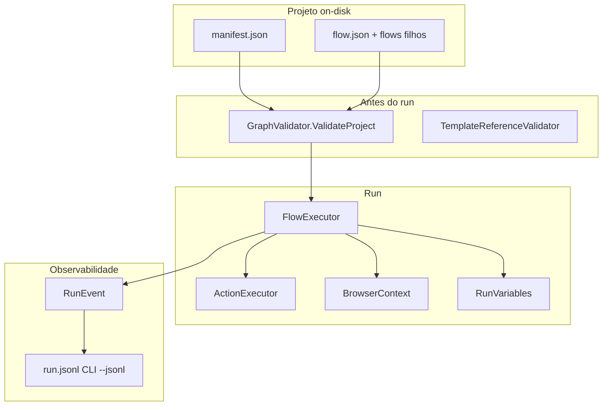

# Runtime e pipeline de execução

## Objetivo

Manter um motor de automação onde o **fluxograma é vista de edição** sobre um programa executável (`flow.json`), com **controle de fluxo** interpretado pelo runtime e **ações** delegadas a executores especializados. O mesmo pipeline serve **CLI**, **testes** e **Studio**, para que validação, execução e logs coincidam.

---

## Camadas

| Camada | Projeto | Responsabilidade |
|--------|---------|------------------|
| Persistência | `Hoblio.Serde` | `manifest.json`, `flow.json`, subfluxos em disco ou embutidos |
| Modelo | `Hoblio.Model` | Grafo, `ActionKind`, `ControlKind`, validação (`GraphValidator`, `TemplateReferenceValidator`) |
| Runtime | `Hoblio.Runtime` | `FlowExecutor`, `ActionExecutor`, browser, arquivos, expressões, eventos |
| Hosts | `Hoblio.Cli`, `Hoblio.Studio` | Entrada do usuário, cancelamento, painel de log, destaque no canvas |



---

## Sequência lógica de um run

1. Carregar projeto (`ProjectLoader.LoadProject`).
2. Validar grafo e projeto (`GraphValidator.ValidateProject` — inclui refs `{variável}` conhecidas).
3. Reset de cancelamento (`RunCancel.Reset`).
4. Abrir contexto de browser único por run (`BrowserContext`). **Todo `run_flow` — subfluxo ou fluxo de outro projeto — executa nesse mesmo contexto**, portanto na mesma sessão/tela; `share_browser` ainda não é lido pelo runtime.
5. Emitir `RunStarted`.
6. Percorrer o grafo a partir de `start`, nó a nó:
   - **Start / End** — marca entrada/saída.
   - **Action** — executa `ActionKind` ou resolve `run_flow` (subfluxo embutido, arquivo ou entrada do manifest).
   - **If / Switch / Case / Case default / ForEach / While / Repeat** — avalia condição ou frame de loop/switch; escolhe aresta (`then`, `else`, `body`, `after`, `main` no default).
   - **Next loop / Exit loop** — manipula o frame de loop ativo.
7. Para cada passo relevante: `NodeEnter`, depois `ActionExecuted` (ações e controles) ou eventos de subfluxo (`FlowStarted` / `FlowFinished`).
8. Emitir `RunFinished` com último nó alcançado.

Limite de segurança: **10 000 visitas de nó** (`MaxNodeVisits`) para detectar ciclo fora de construto de loop.

---

## Dois caminhos no interpretador

| Caminho | Nós | Executor | DLL / plugin futuro |
|---------|-----|----------|---------------------|
| **Controle de fluxo** | `if`, `switch`, `case`, `case_default`, `for_each`, `while_loop`, `repeat`, `next_loop`, `exit_loop` | Lógica em `FlowExecutor` + `ExpressionEvaluator` | Não requer módulo externo |
| **Ação** | `kind: action` | `ActionExecutor.Execute` (+ política de erro) | Catálogo fixo hoje; extensível via módulos |

Subfluxo (`run_flow`) é **ação especial**: resolvida em `FlowExecutor` (profundidade máxima, escopo de variáveis `inherit` vs `isolated`, merge de inputs/outputs). Com `project`, o alvo é o fluxo principal de outro projeto declarado em `manifest.linked_projects` — mesma execução, mesmo browser/variáveis, raiz de arquivos e manifest do projeto chamado. Ver [composicao-superfluxos.md](./composicao-superfluxos.md).

---

## Política de erro por nó

Cada nó de ação pode definir `error_handling`:

| Campo | Efeito |
|-------|--------|
| `retry_count` | Tentativas extras após falha (total = 1 + retry) |
| `retry_delay_ms` | Espera entre tentativas (padrão 500 ms) |
| `on_failure` | `stop` (propaga exceção) ou `continue` (resumo `failed (continued): …` e segue o grafo) |

Retries usam o mesmo `ActionExecutor`; cancelamento cooperativo (`RunCancel`) interrompe também durante `delay` entre tentativas.

**Fora de escopo atual:** ramo dedicado **On error** no grafo (aresta separada após falha). Retry + continue cobrem o subset usado nos demos de resiliência.

---

## Switch / Case (multi-way, estilo PAD)

Semântica alinhada a **if / else if / else** encadeado:

1. **Switch** — resolve a expressão (`{variável}` ou literal) uma vez; empilha `LoopFrameSwitch`; segue aresta **`then`** para o primeiro **Case**.
2. **Case** — compara o valor do switch com `value` usando o operador do controle (`eq`, `contains`, …). **Match** → `then` e remove o frame do switch; **sem match** → **`else`** para o próximo Case.
3. **Case default** — ramo quando nenhum Case combina; remove o frame do switch; aresta de entrada típica: **`else`** do último Case (porta **`main`** no nó default).

Vários Cases no mesmo Switch são suportados (cadeia `else` entre Cases). Para **uma** decisão binária, um nó **`if`** ocupa menos nós no grafo; Switch compensa quando há **vários** ramos sobre a mesma expressão.

Validação: `GraphValidator` exige Switch com `then`, Case com `then`+`else`, subfluxos embutidos validados sem re-aninhar irmãos (`SubflowBundle.AsGraph(null)`).

---

## Serviços por run (estado compartilhado)

| Serviço | Escopo | Motivo |
|---------|--------|--------|
| `RunVariables` | Run ou cópia isolada em subfluxo | Estado mutável entre nós |
| `BrowserContext` | Run (opcionalmente compartilhado) | Sessão CDP única |
| `HttpClient` estático | Processo | `http_get` simples |
| `projectRoot` | Run | Caminhos relativos de arquivo |

Evolução desejada: **container de serviços por run** (browser, repositórios, emissor de log) alimentado na abertura do run — mesmo padrão de “registrar serviços por módulo” quando existirem assemblies de ação plugáveis. Hoje tudo está inlined em `ActionExecutor` e helpers estáticos.

### Contexto do run

`RunContext` escreve duas variáveis **antes do primeiro nó** e as restaura ao voltar de cada `run_flow`:

| Variável | Valores | Muda quando |
|----------|---------|-------------|
| `HoblioRunMode` | `standalone` \| `superflow` | o fluxo é chamado por `run_flow` com `project` (outro projeto) |
| `HoblioRunDepth` | `0`, `1`, `2`, … | cada vínculo de projeto atravessado |

Subfluxo embutido e arquivo do **mesmo** projeto não mudam o modo: o run continua sendo daquele projeto. As duas são públicas para o grafo (`if`, `switch`, `log`) e **não** precisam constar em `variables` — `TemplateReferenceValidator` as conhece via `BuiltInVariables`, e o Studio as oferece no picker de `{variáveis}`.

Para que serve: um fluxo que termina **bloqueando** (caixa de mensagem) ou que **assume uma tela já aberta** (attach por CDP) consegue ramificar com `if {HoblioRunMode} eq standalone` e continuar silencioso quando é etapa de um superfluxo. Casos concretos: [composicao-superfluxos.md §13](./composicao-superfluxos.md).

---

## Fronteiras de código (manter ao crescer)

| Fase | Onde | O quê |
|------|------|--------|
| Design-time | `Hoblio.Model` | Tipos JSON, validação, catálogo de ações (futuro: metadados únicos) |
| Run-time | `Hoblio.Runtime` | Interpretação do grafo, dispatch, políticas, telemetria |
| Domínio pesado | `BrowserContext`, `FileActions`, … | Runtimes atrás de interfaces finas; ações no grafo permanecem descritores pequenos |

Evitar que o Studio ou a paleta hardcodem nomes de log: usar o [catálogo](./catalogo-acoes-e-modulos.md) como fonte de `module` + `action_id`.

---

## Debug e passo a passo (futuro)

Hoje o run é **contínuo** com cancelamento. Um modo passo a passo exigiria:

- Pausar após `NodeEnter` ou `ActionExecuted`.
- Manter mapa **nó id ↔ ordem lógica** (`step_index`) por fluxo/subfluxo.
- Reutilizar o mesmo `FlowExecutor` com callback que bloqueia até “próximo passo”.

A telemetria descrita em [telemetria-e-logs.md](./telemetria-e-logs.md) antecipa os campos necessários para highlight e replay.

---

## Verificação

```powershell
dotnet test
dotnet run --project src/Hoblio.Cli -- validate examples/resilience-demo
dotnet run --project src/Hoblio.Cli -- run examples/flow-control-demo --jsonl
```

Demos por área: [PARITY.md](../PARITY.md).
