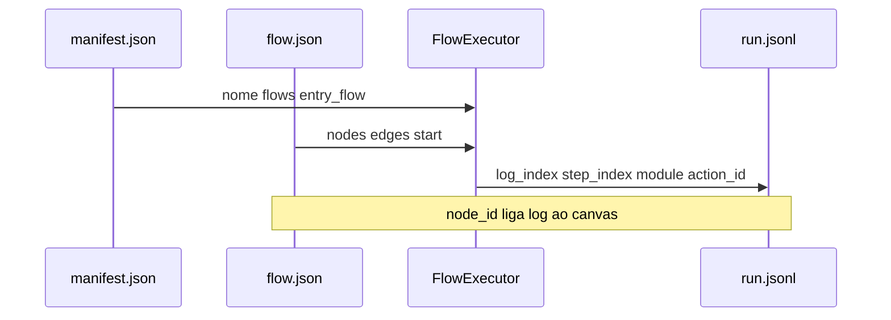

# Telemetria e logs de execução

## Objetivo

Correlacionar **projeto em disco**, **passos do run** e **painel do Studio** com um log estruturado reproduzível. O resumo textual (`summary`) permanece para leitura humana; campos estáveis permitem filtros, diff entre runs e highlight preciso no canvas.

---

## Eventos in-process (`RunEvent`)

| Tipo | Quando | Uso principal |
|------|--------|----------------|
| `RunStarted` | Início | Nome do projeto (`manifest.name`) |
| `NodeEnter` | Antes de processar nó | Destaque no canvas (`node_id`) |
| `NodeExit` | Ao sair de `End` | — |
| `ActionExecuted` | Após ação ou controle | Log + variáveis produzidas |
| `FlowStarted` / `FlowFinished` | Entrada/saída de `run_flow` | Subfluxo (`flow_ref`, `parent_node_id`) |
| `RunFinished` | Fim do run | Último nó |

Cancelamento: exceção `OperationCanceledException`; CLI/Studio tratam como run interrompido.

---

## JSONL na CLI

Com `--jsonl`, cada linha é um objeto JSON (`RunEventJson.Serialize`), gravado em `.hoblio/run.jsonl` no diretório do projeto.

### Formato atual (implementado)

| `kind` | Campos |
|--------|--------|
| `run_started` | `project` |
| `node_enter` | `node_id` |
| `node_exit` | `node_id` |
| `action_executed` | `node_id`, `summary`, `variables?` |
| `flow_started` | `flow_ref`, `parent_node_id` |
| `flow_finished` | `flow_ref`, `end_node_id` |
| `run_finished` | `last_node` |

---

## Formato enriquecido — linha de passo (`action_executed`)

Motivação: separar **ordem lógica no fluxo** de **ordem no arquivo de log** (loops geram múltiplas linhas com o mesmo `step_index` e `log_index` distinto).

Campos emitidos pelo runtime (`RunEventJson`):

| Campo | Tipo | Descrição |
|-------|------|-----------|
| `kind` | string | `action_executed` |
| `log_index` | int | Contador monotônico 1…N no arquivo |
| `flow_ref` | string | Fluxo atual: `manifest.name`, `flow_id` ou rótulo de subfluxo |
| `step_index` | int | Ordem lógica de statements na função (incrementa por passo significativo no grafo) |
| `node_id` | string | Id do nó no `flow.json` |
| `module` | string? | Módulo lógico; null para infra (`RepeatAction`) |
| `action_id` | string | Ver [catálogo](./catalogo-acoes-e-modulos.md) |
| `title` | string? | `node.label` ou título da paleta |
| `summary` | string | Resumo legível (mantido) |
| `status` | string | `Succeeded` \| `Failed` \| `Continued` |
| `inside_error_handling` | bool | true durante retry tratado ou continue |
| `error_code` | string? | Código curto (`WindowNotFound`, `HttpError`, …) |
| `input_variable_names` | string \| string[]? | Variáveis lidas (quando aplicável) |
| `output_variable_names` | string \| string[]? | Variáveis escritas |
| `variables` | object? | Snapshot atual de valores (já existente) |

Eventos de controle (`If`, `Foreach`, …) usam o mesmo shape com `module`/`action_id` dos módulos virtuais.

---

## Correlação projeto → run → log



| Pergunta | Onde responder |
|----------|----------------|
| Quais capacidades o projeto usa? | `manifest.module_references` (futuro) ou scan do grafo |
| Qual nó falhou? | `node_id` + highlight Studio |
| Mesmo passo em loop? | Mesmo `step_index`, `log_index` diferente |
| Subfluxo? | `flow_ref` muda; `parent_node_id` em `flow_started` |

**Gap conhecido:** nem todo nó emite linha equivalente a “statement interno” (ex.: navegação implícita). Documentar exceções quando surgirem; `step_index` pode pular números como em runs comerciais maduros.

---

## PowerShell — inspecionar JSONL

```powershell
$log = Join-Path (Resolve-Path 'examples/demo-flow') '.hoblio/run.jsonl'
Get-Content $log | ForEach-Object {
  $j = $_ | ConvertFrom-Json
  if ($j.kind -eq 'action_executed') {
    [PSCustomObject]@{
      node    = $j.node_id
      summary = $j.summary
    }
  }
} | Format-Table -AutoSize
```

Após implementação dos campos alvo:

```powershell
Get-Content $log | ForEach-Object {
  $j = $_ | ConvertFrom-Json
  if ($j.kind -eq 'action_executed') {
    [PSCustomObject]@{
      log  = $j.log_index
      flow = $j.flow_ref
      mod  = $j.module
      act  = $j.action_id
      st   = $j.status
    }
  }
} | Format-Table -AutoSize
```

---

## Studio

- Lista de log: `summary` + toggle JSON (`RecordRunEvent` em `FlowEditorViewModel.Inspector.cs`).
- Destaque: `NodeEnter` / último `ActionExecuted`.
- Próximo passo: consumir `log_index` + `step_index` para não confundir iterações de loop.

---

## Testes e harness

- Testes atuais assertam `Summary` de `ActionExecuted` ([`DemoFlowTests`](../../tests/Hoblio.Runtime.Tests/DemoFlowTests.cs)).
- Ao enriquecer JSONL, adicionar testes em `RunEventJson` para serialização estável e exemplos golden em `examples/*/`.

Roteiro manual: executar `flow-control-demo` e `resilience-demo` com `--jsonl` e validar sequência `module=Loops|Conditionals`.
